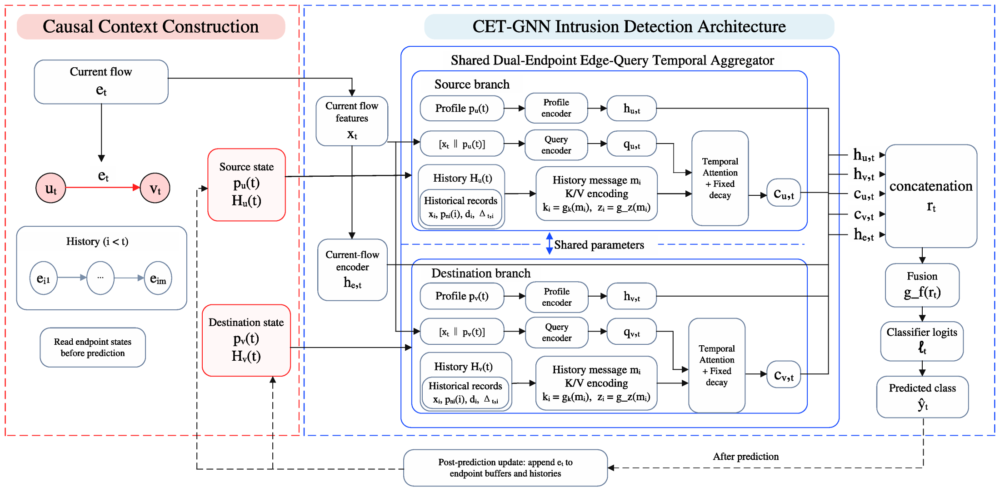

# CET-GNN

Implementation accompanying **CET-GNN: Causal Edge-Query Temporal Graph Neural Network for Long-Tailed Network Intrusion Detection**, by Xiang Li and Gang Chen, Zhengzhou University.

CET-GNN classifies network flows using their attributes and the earlier interactions of both IP endpoints. It represents IP addresses as nodes and flows as directed edges. The current flow queries each endpoint's history, allowing different flows involving the same host to retrieve different evidence.

## Model framework



1. **Causal endpoint profiles:** a nine-dimensional behavioural profile summarises the most recent `W` incident flows at each endpoint.
2. **Edge-query history retrieval:** the current flow and endpoint profile form a query over at most `K` earlier records. Historical messages include flow attributes, the partner's profile, direction, and record-index lag.
3. **Fixed temporal decay:** content-based attention includes a penalty of `beta * log1p(record_distance) / 10`, favouring more recent records with similar content.
4. **Flow classification:** an MLP combines the current flow, the two profiles, and the two retrieved contexts. Endpoint states are updated after the current flow's inputs have been captured.

The final paper configuration is **W=32, K=32, beta=2**, with 128-dimensional hidden and output representations, dropout 0.3, and inverse-square-root class weighting. A window measures incident-flow counts; lag measures record distance. The implementation retains the `cet_graphsage` package and `CETGraphSAGE` class names for checkpoint compatibility; `CETGNN` is also exported as an alias.

## Results reported in the manuscript

Mean and sample standard deviation over seeds **42, 62, and 82**:

| Dataset | Macro-F1 | Tail-F1 | Improvement over the strongest baseline |
| --- | --- | --- | --- |
| NF-UNSW-NB15-v2 | 0.6514 +/- 0.0149 | 0.4843 +/- 0.0171 | +2.78 percentage points over Hu-XGBoost |
| NF-CSE-CIC-IDS2018-v3 | 0.7883 +/- 0.0053 | Not reported | +2.93 percentage points over FN-GNN |
| GridStratLLM | 0.9597 +/- 0.0151 | — | 2.59 percentage points below Hu-XGBoost |

Tail-F1 on NF-UNSW-NB15-v2 averages Analysis, Backdoor, Shellcode, and Worms. These are manuscript results; reproducing the experiments requires the full datasets and the stated protocol. This repository contains the CET-GNN implementation, its ablation switches, and training utilities.

## Dataset downloads

Download the data from the official repositories.

| Dataset | Download / landing page | Persistent identifier |
| --- | --- | --- |
| NF-UNSW-NB15-v2 | [UQ eSpace](https://espace.library.uq.edu.au/view/UQ:ffbb0c1) | [10.48610/ffbb0c1](https://doi.org/10.48610/ffbb0c1) |
| NF-CSE-CIC-IDS2018-v3 | [UQ eSpace](https://espace.library.uq.edu.au/view/UQ:ece9b83) | [10.48610/ece9b83](https://doi.org/10.48610/ece9b83) |
| GridStratLLM | [RADAR4KIT download](https://radar.kit.edu/radar/en/dataset/bx5337kcykte438h) | [10.35097/bx5337kcykte438h](https://doi.org/10.35097/bx5337kcykte438h) |

The authors' [dataset overview](https://staff.itee.uq.edu.au/marius/NIDS_datasets/) describes the NetFlow versions and their feature definitions. Follow the dataset providers' terms and citation requirements. For the NetFlow benchmarks, extract the CSV files into `data/`, or pass their locations with `--data`. The CIC V3 archive may name its CSV `NF-CICIDS2018-v3.csv`.

```text
data/
  NF-UNSW-NB15-v2.csv
  NF-CICIDS2018-v3.csv
```

Datasets, prepared caches, trained weights, and experiment outputs are excluded from Git.

## Installation

Use a Python environment with PyTorch, NumPy, pandas, and scikit-learn. The original experiments used **PyTorch 2.5.1 and CUDA 12.1**. The release was checked with Python 3.9.23, PyTorch 2.5.1, NumPy 2.0.2, pandas 2.3.1, and scikit-learn 1.6.1.

```bash
git clone https://github.com/ChrisTiinaPrPr/CET-GNN.git
cd CET-GNN
python -m venv .venv
# Linux/macOS: source .venv/bin/activate
# Windows PowerShell: .venv\Scripts\Activate.ps1
python -m pip install -r requirements.txt
```

For GPU use, install a PyTorch build compatible with your CUDA setup using the [official PyTorch installation guide](https://pytorch.org/get-started/locally/).

## Training

NF-UNSW-NB15-v2, final model, all three seeds:

```bash
python train.py --dataset unsw-v2 --data data/NF-UNSW-NB15-v2.csv --device cuda
```

NF-CSE-CIC-IDS2018-v3, final model, all three seeds:

```bash
python train.py --dataset cic-v3 --data data/NF-CICIDS2018-v3.csv --device cuda
```

`--device auto` is the default and uses CUDA when available. Use `--device cpu` for a CPU run. Prepared arrays stay on the CPU by default; `--data-backend device` enables the optional GPU-resident batching backend when sufficient GPU memory is available.

Each run uses AdamW (learning rate 0.002, weight decay 0.0001), batch size 512, gradient clipping at 2.0, and at most 50 epochs. Training stops after eight epochs without validation Macro-F1 improvement. The best validation checkpoint is used for testing. `--seeds 42` runs a single seed.

### Data protocols

- **NF-UNSW-NB15-v2:** retain all 2,390,275 records in CSV order and split them 60/20/20. Endpoint history is constructed in that record order. The CSV has no timestamps; record order is the sequence used by this implementation. Numeric flow features are scaled using training statistics only.
- **NF-CSE-CIC-IDS2018-v3:** group attacks into seven categories including Benign; split each category 60/20/20 by flow end time, retaining timestamp ties within a partition. Cap the sampled partitions at 252,000/84,000/84,000 benign flows and 60,000/20,000/20,000 flows per attack category. Sort each partition by end time and build its histories independently. End and start timestamps are excluded from classifier features. Sampling uses seed 42, shared across training seeds.

No labels are used to build endpoint profiles or historical messages. Precomputed histories always refer to earlier records, so shuffled training batches do not introduce future context.

### GridStratLLM training and inference

The GridStratLLM workflow reproduces the paper's binary CET-GNN evaluation. Download the archive from [RADAR4KIT](https://radar.kit.edu/radar/en/dataset/bx5337kcykte438h) and extract the released `merged_datasets.duckdb` into `data/`. Use Python 3.10 or later for the DuckDB preprocessing dependency.

```bash
python -m pip install -r requirements-gridstratllm.txt
python -m cet_graphsage.gridstratllm prepare --database data/merged_datasets.duckdb --output data/gridstratllm_flows.csv.gz
python -m cet_graphsage.gridstratllm train --flows data/gridstratllm_flows.csv.gz --output-dir outputs/gridstratllm
python -m cet_graphsage.gridstratllm predict --flows data/gridstratllm_flows.csv.gz --checkpoint outputs/gridstratllm/seed_42/best_model.pt --split test --labelled-only --output outputs/gridstratllm/test_predictions.csv
```

The preparation step groups TCP packets into five-second segments. It labels attack segments using the released packet annotations and uses traffic outside the annotated attack periods as candidate background. Ambiguous segments remain available as unlabelled history. Histories are built independently in each capture, ordered by segment end time. The train, validation, and test sets contain 38,497, 3,084, and 15,783 labelled segments, respectively.

Training defaults to seeds 42, 62, and 82 and uses at most 60 epochs. Early stopping uses validation Macro-F1 with a patience of 16 epochs after at least 20 epochs. The best checkpoint stores the feature scaling fitted on training rows and the decision threshold selected on the validation split. Each seed produces a checkpoint, training history, test predictions, and per-capture metrics. Use `--device cpu` for CPU training or prediction.

The prediction command uses the saved threshold and writes an attack score and decision for each selected row. With `--split test --labelled-only`, it reproduces the scored test predictions. Omit `--labelled-only` to score unlabelled rows as well, and omit `--split` to score all captures in the input flow table.

### Ablations and sensitivity

Select a paper variant with `--variant`:

| Variant | Configuration |
| --- | --- |
| A0 | Current-flow encoder only |
| A1 | A0 + causal endpoint profiles |
| A2 | A1 + content-based edge-query attention |
| A3 | A2 + lag encoding |
| A4 | A3 + fixed decay; final CET-GNN |
| Q | A4 with decay-only aggregation weights |
| U | A4 with unweighted cross-entropy |

```bash
python train.py --dataset unsw-v2 --variant A3 --seeds 42 62 82
python train.py --dataset unsw-v2 --window 64 --history-size 32 --learned-decay
python train.py --dataset unsw-v2 --window 32 --history-size 32 --beta 1
```

The paper's window and history-length sweeps use learned decay. The fixed-decay sweep uses W=K=32 and beta in {1, 2, 4}.

## Tests and quick verification

```bash
python -m unittest discover -s tests -v
python train.py --dataset unsw-v2 --data data/NF-UNSW-NB15-v2.csv --max-rows 5000 --epochs 1 --seeds 42 --device cpu
```

The limited-row command checks execution only; it is not a paper experiment and may omit rare classes.

## Outputs

Results are written to a new directory under `outputs/`. Each seed saves the best checkpoint (`best_cet_graphsage.pt`), training history, validation/test classification reports, confusion matrices, per-flow predictions, and `metrics_summary.json`. The experiment directory also contains `run_config.json`, `all_runs_metrics.csv`, and `metrics_mean_std.csv`.

```text
CET-GNN/
  cet_graphsage/
    model.py         # CET-GNN and edge-query attention
    data.py          # Causal profiles, histories, scaling and batching
    cic_data.py      # CIC V3 class mapping and temporal split protocol
    gridstratllm_data.py  # GridStratLLM flow preparation and causal histories
    gridstratllm.py       # GridStratLLM training and checkpoint inference
    training.py      # Training, checkpoint selection and evaluation
    gpu_data.py      # Optional GPU-resident batching
  train.py
  tests/
  docs/figures/cet-gnn-framework.png
  data/README.md
  requirements.txt
```
